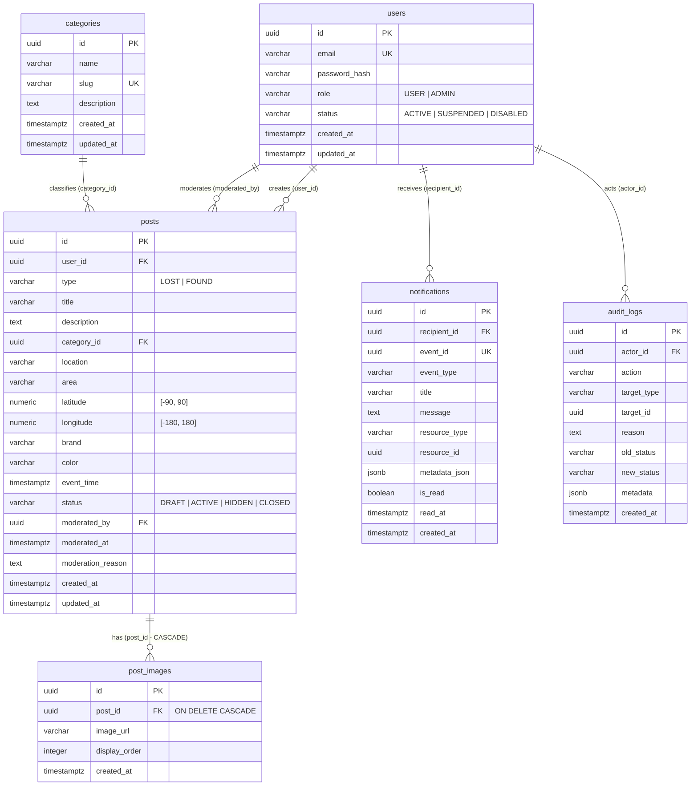

# Kiến trúc Cơ sở dữ liệu FindBack

Tài liệu này mô tả kiến trúc cơ sở dữ liệu thực thi của hệ thống **FindBack – Smart Lost & Found Management System**, được quản lý thông qua **Alembic** migrations và **SQLAlchemy 2.x Async**.

---

## 1. Quyết định Kiến trúc: Chuẩn hóa Định danh UUID

Trước đây, file phác thảo `findback.sql` sử dụng kiểu dữ liệu `BIGINT GENERATED ALWAYS AS IDENTITY` kết hợp trigger đồng bộ trong database (`notify_workflow`).

Trong quá trình triển khai kiến trúc **Modular Monolith hiện đại** cho dự án FindBack, toàn bộ hệ thống đã chuyển sang chuẩn hóa sử dụng **UUID (RFC 4122)** làm khóa chính (`PRIMARY KEY`) cho tất cả các thực thể:
1. **Phân tán & Độc lập**: Các module (`claims_returns`, `posts`, `notifications_admin`) có thể sinh ID client-side / service-side trước khi ghi xuống DB, tối ưu cho kiến trúc event-driven và outbox pattern.
2. **Bảo mật**: Khóa chính UUID ngăn chặn tấn công liệt kê tài nguyên (resource enumeration / ID harvesting) thường gặp với Auto-increment BIGINT.
3. **Loại bỏ Trigger ngầm**: Nghiệp vụ tạo thông báo được điều phối qua Application Service Layer (`NotificationService`) với cơ chế kiểm tra deduplication (`event_id`), không phụ thuộc vào SQL trigger ngầm, tránh tình trạng duplicate notifications hoặc che giấu lỗi giao dịch.

---

## 2. Biểu đồ Quan hệ Thực thể (ERD)



---

## 3. Chi tiết Schema Hiện tại (Revision: `20261117_03`)

### 3.1. Bảng `users` (Shared Identity Model - TV1)

Lưu trữ thông tin định danh và trạng thái tài khoản người dùng:

| Cột | Kiểu dữ liệu | Ràng buộc | Mô tả |
| --- | --- | --- | --- |
| `id` | `UUID` | `PRIMARY KEY` | Định danh người dùng |
| `email` | `VARCHAR(255)` | `NOT NULL, UNIQUE` | Email đăng nhập, đã chuẩn hóa chữ thường |
| `password_hash` | `VARCHAR(255)` | `NOT NULL` | Mật khẩu đã hash |
| `role` | `VARCHAR(30)` | `NOT NULL, CHECK (role IN ('USER', 'ADMIN'))` | Vai trò hệ thống |
| `status` | `VARCHAR(30)` | `NOT NULL, CHECK (status IN ('ACTIVE', 'SUSPENDED', 'DISABLED'))` | Trạng thái tài khoản |
| `created_at` | `TIMESTAMPTZ` | `NOT NULL, DEFAULT NOW()` | Thời điểm tạo |
| `updated_at` | `TIMESTAMPTZ` | `NOT NULL, DEFAULT NOW()` | Thời điểm cập nhật cuối |

### 3.2. Bảng `categories` (Module Posts - TV2 / TV3)

Danh mục đồ vật phân loại động (không dùng enum cứng trong DB):

| Cột | Kiểu dữ liệu | Ràng buộc | Mô tả |
| --- | --- | --- | --- |
| `id` | `UUID` | `PRIMARY KEY` | Định danh danh mục (RFC 4122) |
| `name` | `VARCHAR(100)` | `NOT NULL` | Tên hiển thị của danh mục (Điện tử, Ví da, v.v.) |
| `slug` | `VARCHAR(100)` | `NOT NULL, UNIQUE` | Slug URL (dien-tu, vi-da) |
| `description` | `TEXT` | `NULL` | Mô tả chi tiết danh mục |
| `created_at` | `TIMESTAMPTZ` | `NOT NULL, DEFAULT NOW()` | Thời điểm tạo |
| `updated_at` | `TIMESTAMPTZ` | `NOT NULL, DEFAULT NOW()` | Thời điểm cập nhật |

- **Indexes**: `uq_categories_slug` (`UNIQUE`, do `UniqueConstraint` tự động tạo).

### 3.3. Bảng `posts` (Module Posts - TV2, dùng chung TV5 Admin Moderation)

Lưu trữ thông tin bài đăng tìm đồ thất lạc (`LOST`) hoặc nhặt được đồ (`FOUND`):

| Cột | Kiểu dữ liệu | Ràng buộc | Mô tả |
| --- | --- | --- | --- |
| `id` | `UUID` | `PRIMARY KEY` | Định danh bài đăng |
| `user_id` | `UUID` | `NOT NULL, FOREIGN KEY (users.id) ON DELETE RESTRICT` | Tác giả bài đăng |
| `type` | `VARCHAR(10)` | `NOT NULL, CHECK (type IN ('LOST', 'FOUND'))` | Loại tin đăng |
| `title` | `VARCHAR(255)` | `NOT NULL, CHECK (length(trim(title)) > 0)` | Tiêu đề bài đăng |
| `description` | `TEXT` | `NOT NULL, CHECK (length(trim(description)) > 0)` | Nội dung mô tả chi tiết |
| `category_id` | `UUID` | `NULL, FOREIGN KEY (categories.id) ON DELETE SET NULL` | Danh mục đồ vật |
| `location` | `VARCHAR(255)` | `NULL` | Tên địa điểm (tòa nhà, phòng, công viên) |
| `area` | `VARCHAR(100)` | `NULL` | Khu vực hành chính / địa lý |
| `latitude` | `NUMERIC(9,6)` | `NULL, CHECK (latitude BETWEEN -90.0 AND 90.0)` | Tọa độ vĩ độ |
| `longitude` | `NUMERIC(9,6)` | `NULL, CHECK (longitude BETWEEN -180.0 AND 180.0)` | Tọa độ kinh độ |
| `brand` | `VARCHAR(100)` | `NULL` | Nhãn hiệu đồ vật (Apple, Honda, Casio) |
| `color` | `VARCHAR(100)` | `NULL` | Màu sắc đồ vật |
| `event_time` | `TIMESTAMPTZ` | `NULL` | Thời điểm đánh rơi hoặc nhặt được |
| `status` | `VARCHAR(20)` | `NOT NULL, DEFAULT 'ACTIVE', CHECK (status IN ('DRAFT', 'ACTIVE', 'HIDDEN', 'CLOSED'))` | Trạng thái bài đăng |
| `moderated_by` | `UUID` | `NULL, FOREIGN KEY (users.id) ON DELETE RESTRICT` | Quản trị viên kiểm duyệt (RESTRICT bảo vệ audit history) |
| `moderated_at` | `TIMESTAMPTZ` | `NULL` | Thời điểm kiểm duyệt |
| `moderation_reason` | `TEXT` | `NULL` | Lý do kiểm duyệt |
| `created_at` | `TIMESTAMPTZ` | `NOT NULL, DEFAULT NOW()` | Thời điểm tạo bài |
| `updated_at` | `TIMESTAMPTZ` | `NOT NULL, DEFAULT NOW()` | Thời điểm cập nhật cuối |

#### Check Constraints trên `posts`:
- `ck_posts_type`: `type IN ('LOST', 'FOUND')`
- `ck_posts_status`: `status IN ('DRAFT', 'ACTIVE', 'HIDDEN', 'CLOSED')`
- `ck_posts_title_not_empty`: `length(trim(title)) > 0`
- `ck_posts_description_not_empty`: `length(trim(description)) > 0`
- `ck_posts_moderation`: `(moderated_by IS NULL AND moderated_at IS NULL AND moderation_reason IS NULL) OR (moderated_by IS NOT NULL AND moderated_at IS NOT NULL AND length(trim(moderation_reason)) > 0)`
- `ck_posts_latitude`: `latitude IS NULL OR (latitude BETWEEN -90.0 AND 90.0)`
- `ck_posts_longitude`: `longitude IS NULL OR (longitude BETWEEN -180.0 AND 180.0)`
- `ck_posts_coordinates`: `(latitude IS NULL) = (longitude IS NULL)` *(Đảm bảo hoặc cả hai tọa độ cùng có, hoặc cả hai cùng NULL)*

#### Indexes trên `posts`:
- `ix_posts_user_id`: `(user_id)`
- `ix_posts_status`: `(status)`
- `ix_posts_type`: `(type)`
- `ix_posts_category_id`: `(category_id)`
- `ix_posts_created_at`: `(created_at DESC)`
- `ix_posts_admin_list`: `(status, type, created_at DESC)`

### 3.4. Bảng `post_images` (Module Posts - TV2)

Lưu trữ ảnh công khai đính kèm bài đăng (tuyệt đối không lưu bằng chứng claim riêng tư tại đây):

| Cột | Kiểu dữ liệu | Ràng buộc | Mô tả |
| --- | --- | --- | --- |
| `id` | `UUID` | `PRIMARY KEY` | Định danh ảnh |
| `post_id` | `UUID` | `NOT NULL, FOREIGN KEY (posts.id) ON DELETE CASCADE` | ID bài đăng liên kết |
| `image_url` | `VARCHAR(500)` | `NOT NULL` | URL hoặc Storage Key của ảnh |
| `display_order` | `INTEGER` | `NOT NULL, DEFAULT 0` | Thứ tự hiển thị |
| `created_at` | `TIMESTAMPTZ` | `NOT NULL, DEFAULT NOW()` | Thời điểm tải lên |

- **Indexes**:
  - `ix_post_images_post_id`: `(post_id)`
  - `ix_post_images_post_order`: `(post_id, display_order)`

> [!NOTE] Phân biệt Xóa Bản ghi Cơ sở Dữ liệu và Tệp Vật lý (Storage)
> Ràng buộc `ON DELETE CASCADE` của PostgreSQL chỉ chịu trách nhiệm xóa **các dòng dữ liệu (records)** trong bảng `post_images` khi bản ghi cha trong `posts` bị xóa. Ràng buộc này **không tự động xóa tệp ảnh vật lý** được lưu trữ trên Object Storage (S3 / MinIO) hoặc hệ thống tệp local. Quy trình dọn dẹp tệp vật lý phải do Application Service Layer hoặc Storage Lifecycle Worker đảm nhiệm để tránh tích lũy tệp mồ côi (orphaned files).

### 3.5. Bảng `notifications` (Module Notifications / Admin - TV5 - KAN-31)

Lưu trữ thông báo gửi tới người dùng trong ứng dụng:

| Cột | Kiểu dữ liệu | Ràng buộc | Mô tả |
| --- | --- | --- | --- |
| `id` | `UUID` | `PRIMARY KEY` | Định danh thông báo |
| `recipient_id` | `UUID` | `NOT NULL, FOREIGN KEY (users.id) ON DELETE CASCADE` | ID người nhận |
| `event_id` | `UUID` | `NULL, UNIQUE` | ID của sự kiện phát sinh (dùng cho Idempotency / Deduplication) |
| `event_type` | `VARCHAR(50)` | `NOT NULL` | Loại sự kiện (CLAIM_CREATED, POST_HIDDEN, v.v.) |
| `title` | `VARCHAR(255)` | `NOT NULL` | Tiêu đề thông báo |
| `message` | `TEXT` | `NOT NULL` | Nội dung thông báo |
| `resource_type` | `VARCHAR(50)` | `NULL` | Loại tài nguyên liên kết (`CLAIM`, `POST`, `RETURN`) |
| `resource_id` | `UUID` | `NULL` | ID tài nguyên liên kết |
| `metadata_json` | `JSONB` | `NULL` | Dữ liệu mở rộng đã được làm sạch bảo mật (allowlist) |
| `is_read` | `BOOLEAN` | `NOT NULL, DEFAULT FALSE` | Trạng thái đã đọc |
| `read_at` | `TIMESTAMPTZ` | `NULL` | Thời điểm đánh dấu đã đọc |
| `created_at` | `TIMESTAMPTZ` | `NOT NULL, DEFAULT NOW()` | Thời điểm tạo thông báo |

- **Indexes**:
  - `ix_notifications_recipient_created`: `(recipient_id, created_at DESC)`
  - `ix_notifications_recipient_read`: `(recipient_id, is_read)`
  - `ix_notifications_event_id`: `UNIQUE (event_id)`

### 3.6. Bảng `audit_logs` (Module Notifications / Admin - TV5 - KAN-32)

Lưu trữ nhật ký kiểm duyệt và các hành động nhạy cảm của quản trị viên:

| Cột | Kiểu dữ liệu | Ràng buộc | Mô tả |
| --- | --- | --- | --- |
| `id` | `UUID` | `PRIMARY KEY` | Định danh bản ghi audit |
| `actor_id` | `UUID` | `NOT NULL, FOREIGN KEY (users.id) ON DELETE RESTRICT` | Admin thực hiện hành động |
| `action` | `VARCHAR(50)` | `NOT NULL` | Hành động (ví dụ `HIDE`) |
| `target_type` | `VARCHAR(50)` | `NOT NULL` | Loại tài nguyên mục tiêu (ví dụ `POST`) |
| `target_id` | `UUID` | `NOT NULL` | ID tài nguyên mục tiêu |
| `reason` | `TEXT` | `NOT NULL` | Lý do thực hiện hành động |
| `old_status` | `VARCHAR(20)` | `NULL` | Trạng thái trước thao tác |
| `new_status` | `VARCHAR(20)` | `NULL` | Trạng thái sau thao tác |
| `metadata` | `JSONB` | `NULL` | Dữ liệu mở rộng liên quan |
| `created_at` | `TIMESTAMPTZ` | `NOT NULL, DEFAULT NOW()` | Thời điểm ghi nhận log |

- **Indexes**:
  - `ix_audit_logs_actor`: `(actor_id, created_at DESC)`
  - `ix_audit_logs_target`: `(target_type, target_id, created_at DESC)`
  - `ix_audit_logs_created`: `(created_at DESC)`

---

## 4. Lịch sử Migration (Alembic)

Các migration được đặt tại `backend/alembic/versions/`:

- **Revision `20261117_01_initial_users_notifications`**:
  - Tạo bảng `users` với các Check Constraint `role`, `status`.
  - Tạo bảng `notifications` với FK `users.id`, Unique Constraint `event_id`, và các Composite Indexes.
  - Hỗ trợ đầy đủ cả `upgrade` (head) và `downgrade` (base).
- **Revision `20261117_02_posts_and_audit_logs`**:
  - Tạo bảng `posts` với các Check Constraint `type`, `status`, `moderation` và Composite Indexes phục vụ quản trị.
  - Tạo bảng `audit_logs` với FK `users.id`, indexes tra cứu theo `target` và `actor`.
  - Hỗ trợ đầy đủ cả `upgrade` và `downgrade`.
- **Revision `20261117_03_complete_posts_schema`**:
  - Tạo bảng `categories` (UUID id, name, slug UNIQUE, description, created_at, updated_at).
  - Thêm FK `posts.category_id -> categories.id ON DELETE SET NULL`.
  - Bổ sung các cột tọa độ GPS (`latitude`, `longitude`) và chi tiết vật phẩm (`brand`, `color`, `event_time`) vào bảng `posts`.
  - Thêm Check Constraints: `ck_posts_latitude`, `ck_posts_longitude`, `ck_posts_coordinates`.
  - Tạo bảng `post_images` với FK `posts.id ON DELETE CASCADE`, `image_url`, `display_order`.
  - Hỗ trợ đầy đủ cả `upgrade` và `downgrade`.
- **Revision `20261117_04_fix_moderation_fk_and_duplicate_index`**:
  - Loại bỏ index trùng lặp `ix_categories_slug` trên bảng `categories` (giữ nguyên index duy nhất `uq_categories_slug` do `UniqueConstraint` sinh ra).
  - Điều chỉnh `fk_posts_moderated_by` từ `ON DELETE SET NULL` sang `ON DELETE RESTRICT` để bảo vệ tính toàn vẹn của lịch sử kiểm duyệt (audit trail) và loại bỏ hoàn toàn xung đột với ràng buộc `ck_posts_moderation`.
  - Hỗ trợ đầy đủ cả `upgrade` và `downgrade`.

---

## 5. Hướng dẫn Tích hợp dành cho Thành viên TV2 (Module Posts)

TV2 phụ trách module Posts có thể sử dụng trực tiếp các model đã định nghĩa:

```python
from app.modules.posts.models import Category, Post, PostImage
```

1. **Category**:
   - Sử dụng quan hệ `post.category` (được cấu hình `lazy="selectin"`).
   - Xóa category an toàn: Post liên kết sẽ tự động chuyển `category_id = NULL` (`ON DELETE SET NULL`), không làm mất bài đăng của người dùng.
2. **Post Images**:
   - Gắn danh sách ảnh qua `post.images = [PostImage(image_url="..."), ...]`.
   - Khi xóa bài đăng (`session.delete(post)`), toàn bộ bản ghi `post_images` liên kết sẽ tự động bị xóa trong database theo cơ chế cascading (`ON DELETE CASCADE` và `cascade="all, delete-orphan"`).
   - **Lưu ý nghiệp vụ TV2**: Ràng buộc database CASCADE chỉ xóa bản ghi dữ liệu; TV2 cần xây dựng logic / worker dọn dẹp file vật lý tương ứng trên Object Storage để tránh tồn đọng file rác (orphaned files).
3. **Coordinates & Mutual Constraints**:
   - Người dùng có thể cung cấp cả hai tọa độ (`latitude`, `longitude`) hoặc để trống cả hai (`NULL`).
   - Nếu client gửi chỉ một tọa độ (ví dụ chỉ gửi latitude mà không gửi longitude), database sẽ từ chối qua ràng buộc `ck_posts_coordinates`.
4. **Moderation Compatibility**:
   - `Post` model dùng chung giữa TV2 (tạo, sửa, xem bài) và TV5 (admin kiểm duyệt bài `status="HIDDEN"`).
   - Khi TV5 ẩn bài đăng, `status` chuyển thành `HIDDEN` và lưu `moderated_by`, `moderated_at`, `moderation_reason`. TV2 có thể hiển thị thông tin này nếu cần thiết hoặc lọc bỏ các bài `status != 'ACTIVE'` trong danh sách tìm kiếm công khai.
