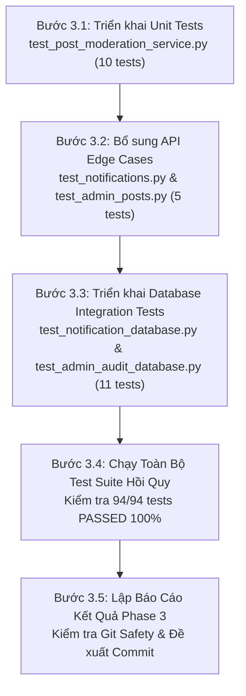

# KẾ HOẠCH KIỂM THỬ VÀ MA TRẬN BAO PHỦ (TEST PLAN & TEST COVERAGE MATRIX)
## JIRA KAN-33: NOTIFICATION & ADMIN UNIT TESTING

**Dự án:** FindBack – Smart Lost & Found Management System
**Repository:** `FindBack-Smart-Lost-Found-Management-System`
**Nhánh làm việc:** `vu`
**Tác giả:** Đội ngũ phát triển Backend FindBack
**Ngày lập kế hoạch:** 17/11/2026
**Trạng thái tài liệu:** Phase 2 Complete – Chờ phê duyệt trước khi viết mã nguồn (Phase 3)

---

## MỤC LỤC
1. [Tổng quan & Mục tiêu](#1-tổng-quan--mục-tiêu)
2. [Hiện trạng Kiểm thử Hệ thống (Baseline Audit Phase 1)](#2-hiện-trạng-kiểm-thử-hệ-thống-baseline-audit-phase-1)
3. [Phân tích Khoảng trống Kiểm thử (Test Gap Analysis)](#3-phân-tích-khoảng-trống-kiểm-thử-test-gap-analysis)
4. [Ma trận Bao phủ Kiểm thử Chi tiết (Test Coverage Matrix A–H)](#4-ma-trận-bao-phủ-kiểm-thử-chi-tiết-test-coverage-matrix-ah)
   - [Nhóm A: Notification Service Unit Tests](#nhóm-a-notification-service-unit-tests)
   - [Nhóm B: Notification API Tests](#nhóm-b-notification-api-tests)
   - [Nhóm C: PostModerationService Unit Tests](#nhóm-c-postmoderationservice-unit-tests)
   - [Nhóm D: Admin Posts API Tests](#nhóm-d-admin-posts-api-tests)
   - [Nhóm E: Notification Database Integration Tests](#nhóm-e-notification-database-integration-tests)
   - [Nhóm F: Admin Audit & Transaction Integration Tests](#nhóm-f-admin-audit--transaction-integration-tests)
   - [Nhóm G: Authentication, Authorization & Security Tests](#nhóm-g-authentication-authorization--security-tests)
   - [Nhóm H: Test Isolation, Reliability & Regression Tests](#nhóm-h-test-isolation-reliability--regression-tests)
5. [Danh mục File Kiểm thử & Kế hoạch Phân bổ (Target Files Inventory)](#5-danh-mục-file-kiểm-thử--kế-hoạch-phân-bổ-target-files-inventory)
6. [Phân tích Rủi ro Kỹ thuật & Chiến lược Kiểm soát](#6-phân-tích-rủi-ro-kỹ-thuật--chiến-lược-kiểm-soát)
7. [Lộ trình Triển khai Phase 3 (Execution Roadmap)](#7-lộ-trình-triển-khai-phase-3-execution-roadmap)
8. [Nguyên tắc An toàn & Quy chuẩn Kiểm thử](#8-nguyên-tắc-an-toàn--quy-chuẩn-kiểm-thử)

---

## 1. TỔNG QUAN & MỤC TIÊU

### 1.1. Bối cảnh dự án
Hệ thống FindBack xây dựng theo kiến trúc **Modular Monolith**, áp dụng mô hình phân lớp nghiêm ngặt:
$$\text{Router} \longrightarrow \text{Service} \longrightarrow \text{Repository} \longrightarrow \text{Database}$$
Trong các giai đoạn trước:
- **Jira KAN-31:** Triển khai nền tảng Backend Foundation và module Thông báo (`notifications_admin/notifications`), hỗ trợ thông báo in-app, làm sạch dữ liệu nhạy cảm (sanitization), khử trùng lặp sự kiện (deduplication với UUIDv5).
- **Jira KAN-32:** Triển khai tính năng Điều phối bài viết dành cho Quản trị viên (`PostModerationService`), hệ thống ghi vết kiểm toán (`AuditLog`), liên kết thông báo `POST_HIDDEN`, và hoàn thiện toàn bộ schema Cơ sở dữ liệu Posts (Categories, Post Images, Check Constraints GPS, On Delete Restrict). Mã nguồn đã được commit an toàn tại `ceeea96` và push lên GitHub remote `origin/vu`.

### 1.2. Mục tiêu Jira KAN-33
Mục tiêu cốt lõi của KAN-33 là thiết lập hệ thống kiểm thử toàn diện (Unit Test, API Test, Integration Test, Security Test, Regression Test) cho hai phân hệ cốt lõi: **Notification** và **Admin Post Moderation**.
Hệ thống kiểm thử sau khi hoàn thành phải đảm bảo:
1. **Kiểm thử độc lập cấp Unit (Unit Isolation):** Tách biệt logic nghiệp vụ trong Service khỏi Cơ sở dữ liệu bằng kỹ thuật Mocking, đạt thời gian thực thi siêu tốc (< 1s).
2. **Kiểm thử tích hợp dữ liệu (Database Integrity):** Xác minh trực tiếp trên PostgreSQL các ràng buộc dữ liệu toàn vẹn (Foreign Key RESTRICT, CASCADE, Unique Constraints, Check Constraints, Row Locking `SELECT FOR UPDATE`).
3. **Kiểm thử giao tiếp API & Bảo mật (API & Security):** Bảo đảm phân quyền nghiêm ngặt (RBAC), không rò rỉ dữ liệu nhạy cảm (passwords, tokens, private metadata), xử lý các trường hợp ngoại lệ phân trang và tham số đầu vào.
4. **Bảo toàn 100% tỷ lệ Pass:** Giữ vững 68 test case hiện có và mở rộng thêm ~26 test case mới, đưa tổng số test case đạt ~94 test case đạt chuẩn chất lượng cao.

---

## 2. HIỆN TRẠNG KIỂM THỬ HỆ THỐNG (BASELINE AUDIT PHASE 1)

Kết quả kiểm toán Phase 1 cho thấy hệ sinh thái kiểm thử hiện tại đã có nền tảng vững chắc với **68/68 test case PASSED** trên cơ sở dữ liệu kiểm thử cô lập `findback_test`:

| File kiểm thử | Vị trí | Số lượng test | Mục tiêu kiểm thử chính |
| :--- | :--- | :---: | :--- |
| `test_notification_service.py` | `backend/tests/unit/notifications_admin/` | **10** | Unit tests kiểm tra hàm làm sạch metadata, phát hiện token/password lồng sâu, kiểm tra quyền sở hữu và người nhận không hoạt động. |
| `test_notifications.py` | `backend/tests/api/` | **18** | API tests kiểm tra xác thực JWT, phân trang, lọc `is_read`, đánh dấu đã đọc idempotent, ngăn chặn trùng lặp thông báo nội bộ. |
| `test_admin_posts.py` | `backend/tests/api/` | **25** | API tests kiểm tra RBAC (Admin vs Normal User), phân trang, lọc status/type, tìm kiếm từ khóa, ẩn bài viết, rollback giao dịch khi lỗi. |
| `test_posts_schema.py` | `backend/tests/api/` | **15** | Integration tests kiểm tra schema Posts hoàn thiện (Categories, PostImages, GPS coordinates, FK Restrict khi xóa Admin). |
| **TỔNG CỘNG** | | **68** | **Tỷ lệ vượt qua: 100% (68/68 PASSED in ~36s)** |

---

## 3. PHÂN TÍCH KHOẢNG TRỐNG KIỂM THỬ (TEST GAP ANALYSIS)

Dù đã có 68 test case hoạt động tốt, quá trình phân tích chuyên sâu phát hiện các khoảng trống quan trọng cần bổ sung trong KAN-33:

1. **Khoảng trống Unit Test cho `PostModerationService`:**
   - Hiện tại toàn bộ 25 test case của KAN-32 đều chạy ở tầng HTTP API (`test_admin_posts.py`), phụ thuộc hoàn toàn vào Database và HTTP engine.
   - `PostModerationService` chưa có bất kỳ Unit Test cô lập nào sử dụng Mock (`AsyncMock`). Do đó, các trường hợp tính toán số trang (`total_pages = math.ceil(total / limit)`), validate `VALID_STATUSES`, `VALID_TYPES`, hay kiểm thử logic nhánh ngoại lệ chưa được kiểm thử ở cấp độ hàm thuần túy.

2. **Khoảng trống Database Integration độc lập:**
   - Thư mục `backend/tests/integration/` hiện tại chỉ chứa file trống (`.gitkeep`, `__init__.py`).
   - Các ràng buộc cấp DB như `event_id UNIQUE`, `fk_notifications_recipient CASCADE`, `fk_posts_moderated_by RESTRICT`, `fk_audit_logs_actor RESTRICT`, và `ck_posts_moderation` cần có các integration test riêng biệt để kiểm tra tính toàn vẹn tầng lưu trữ mà không thông qua REST router.

3. **Khoảng trống Giá trị Biên API (API Boundary Cases):**
   - Các tham số phân trang chưa được kiểm thử giá trị âm hoặc vượt ngưỡng (`page=0`, `page=-1`, `limit=0`, `limit=101`).
   - Truyền tham số đường dẫn không đúng định dạng UUID (ví dụ `/admin/posts/not-a-uuid/moderate`) chưa có test case xác nhận trả về mã lỗi `422 Unprocessable Entity`.
   - Kết hợp đồng thời nhiều bộ lọc (`status` + `type` + `q`) chưa có test case chuyên biệt.

4. **Kiểm tra Rà soát Rò rỉ Dữ liệu Nhạy cảm (Zero Sensitive Leakage):**
   - Cần bổ sung test case đảm bảo phản hồi API thông báo không bao giờ chứa thông tin nhạy cảm của người nhận (như `password_hash`, auth tokens, token phiên làm việc).

---

## 4. MA TRẬN BAO PHỦ KIỂM THỬ CHI TIẾT (TEST COVERAGE MATRIX A–H)

Mỗi test case dưới đây được phân loại chi tiết theo 8 trường thông tin chuẩn mực:
- **Test ID:** Mã định danh duy nhất theo cú pháp `KAN33-<Group>-<Number>`
- **Test Level:** Phân tầng kiểm thử (`Unit`, `API`, `Integration`, `Regression`)
- **Chức năng:** Tên chức năng/nghiệp vụ được kiểm thử
- **Scenario:** Kịch bản/tình huống kiểm thử cụ thể
- **Input / Setup:** Dữ liệu đầu vào, trạng thái mock hoặc fixture
- **Expected Result:** Kết quả kỳ vọng (giá trị trả về, exception, HTTP status, trạng thái DB)
- **File kiểm thử:** Đường dẫn tương đối của file chứa mã kiểm thử
- **Trạng thái:** `Hiện có` (đã có từ KAN-31/32) hoặc `Mới` (sẽ triển khai trong KAN-33 Phase 3)

---

### NHÓM A: NOTIFICATION SERVICE UNIT TESTS
*Mục đích:* Kiểm tra logic nghiệp vụ nội tại của `NotificationService` độc lập với cơ sở dữ liệu: làm sạch dữ liệu nhạy cảm (sanitization), xác thực người nhận, và kiểm soát quyền sở hữu.

| Test ID | Test Level | Chức năng | Scenario | Input / Setup | Expected Result | File kiểm thử | Trạng thái |
| :--- | :--- | :--- | :--- | :--- | :--- | :--- | :--- |
| **KAN33-A-01** | Unit | Metadata Sanitization | Dữ liệu metadata hợp lệ | Metadata chứa các trường được phép: `post_title`, `post_id`, `reason` | Dữ liệu được giữ nguyên, không ném lỗi | `tests/unit/notifications_admin/test_notification_service.py` | Hiện có |
| **KAN33-A-02** | Unit | Metadata Sanitization | Phát hiện và loại bỏ `token` ở root level | Metadata chứa key `"token": "secret_abc"` | Ném `ValidationError` hoặc loại bỏ trường cấm | `tests/unit/notifications_admin/test_notification_service.py` | Hiện có |
| **KAN33-A-03** | Unit | Metadata Sanitization | Phát hiện `token` lồng trong object con | Metadata chứa `{"details": {"access_token": "xyz"}}` | Ném `ValidationError`, ngăn chặn rò rỉ token | `tests/unit/notifications_admin/test_notification_service.py` | Hiện có |
| **KAN33-A-04** | Unit | Metadata Sanitization | Phát hiện `password` lồng trong mảng | Metadata chứa `{"history": [{"password_hash": "hash"}]}` | Ném `ValidationError`, ngăn chặn lồng mảng chứa pass | `tests/unit/notifications_admin/test_notification_service.py` | Hiện có |
| **KAN33-A-05** | Unit | Metadata Sanitization | Key nhạy cảm viết hoa/thường lẫn lộn | Metadata chứa `"PASSWORD": "123"` hoặc `"ToKeN": "abc"` | Chuẩn hóa lowercase và phát hiện vi phạm, ném lỗi | `tests/unit/notifications_admin/test_notification_service.py` | Hiện có |
| **KAN33-A-06** | Unit | Metadata Sanitization | Các biến thể tên khóa nhạy cảm | Metadata chứa `"auth_secret"`, `"client_secret"`, `"apikey"` | Nhận diện biến thể danh sách đen và từ chối | `tests/unit/notifications_admin/test_notification_service.py` | Hiện có |
| **KAN33-A-07** | Unit | Metadata Sanitization | Trường không nằm trong whitelist | Metadata chứa các trường tùy tiện không được định nghĩa | Ném `ValidationError` (chỉ chấp nhận schema hợp lệ) | `tests/unit/notifications_admin/test_notification_service.py` | Hiện có |
| **KAN33-A-08** | Unit | Metadata Sanitization | Dữ liệu lồng quá nhiều cấp (Deep Nesting) | Metadata lồng quá 5 cấp object | Ném `ValidationError` ngăn chặn tấn công DoS/Recursion | `tests/unit/notifications_admin/test_notification_service.py` | Hiện có |
| **KAN33-A-09** | Unit | Service Ownership | Kiểm tra quyền truy cập thông báo | Mock user A yêu cầu truy cập thông báo của user B | Ném `ForbiddenError` (403) ngăn chặn truy cập trái phép | `tests/unit/notifications_admin/test_notification_service.py` | Hiện có |
| **KAN33-A-10** | Unit | Recipient Validation | Người nhận không ở trạng thái ACTIVE | Mock recipient có trạng thái `SUSPENDED` hoặc `DISABLED` | Ném `BadRequestError` / `ValidationError` không tạo notify | `tests/unit/notifications_admin/test_notification_service.py` | Hiện có |

---

### NHÓM B: NOTIFICATION API TESTS
*Mục đích:* Kiểm tra các API endpoint của thông báo (`/api/v1/notifications`) qua HTTP client: xác thực danh tính, phân trang, lọc trạng thái, đánh dấu đã đọc, và phòng ngừa rò rỉ dữ liệu.

| Test ID | Test Level | Chức năng | Scenario | Input / Setup | Expected Result | File kiểm thử | Trạng thái |
| :--- | :--- | :--- | :--- | :--- | :--- | :--- | :--- |
| **KAN33-B-01** | API | System Health | Kiểm tra endpoint health check | `GET /health` | HTTP 200, status: "ok" | `tests/api/test_notifications.py` | Hiện có |
| **KAN33-B-02** | API | Authentication | Yêu cầu không có Authorization header | `GET /api/v1/notifications` không gửi header token | HTTP 401 Unauthorized | `tests/api/test_notifications.py` | Hiện có |
| **KAN33-B-03** | API | Authentication | Token là UUID thô thay vì JWT | `Authorization: Bearer <raw-uuid>` | HTTP 401 Unauthorized | `tests/api/test_notifications.py` | Hiện có |
| **KAN33-B-04** | API | Authentication | JWT có chữ ký sai (Invalid signature) | JWT ký bằng secret giả mạo | HTTP 401 Unauthorized | `tests/api/test_notifications.py` | Hiện có |
| **KAN33-B-05** | API | Authentication | JWT đã hết hạn (Expired token) | JWT có `exp` trong quá khứ | HTTP 401 Unauthorized | `tests/api/test_notifications.py` | Hiện có |
| **KAN33-B-06** | API | Authentication | JWT sử dụng thuật toán cấm (Algorithm 'none') | JWT header `alg: none` | HTTP 401 Unauthorized | `tests/api/test_notifications.py` | Hiện có |
| **KAN33-B-07** | API | Authentication | JWT chứa user ID không tồn tại trong DB | JWT hợp lệ nhưng user ID không có trong cơ sở dữ liệu | HTTP 401 Unauthorized | `tests/api/test_notifications.py` | Hiện có |
| **KAN33-B-08** | API | Authorization | Người dùng bị tạm đình chỉ (SUSPENDED) | User có `status="SUSPENDED"` gửi yêu cầu API | HTTP 403 Forbidden | `tests/api/test_notifications.py` | Hiện có |
| **KAN33-B-09** | API | Authorization | Người dùng bị vô hiệu hóa (DISABLED) | User có `status="DISABLED"` gửi yêu cầu API | HTTP 403 Forbidden | `tests/api/test_notifications.py` | Hiện có |
| **KAN33-B-10** | API | Access Control | Người dùng ACTIVE truy cập hợp lệ | User có `status="ACTIVE"`, JWT hợp lệ | HTTP 200 OK, trả về danh sách thông báo | `tests/api/test_notifications.py` | Hiện có |
| **KAN33-B-11** | API | Data Isolation | Người dùng chỉ thấy thông báo của chính mình | Tạo thông báo cho User 1 và User 2; User 1 gọi API | Chỉ trả về danh sách thông báo của User 1 | `tests/api/test_notifications.py` | Hiện có |
| **KAN33-B-12** | API | Pagination | Phân trang danh sách thông báo | 15 thông báo, gọi `page=1&limit=10` và `page=2&limit=10` | Page 1 trả về 10 mục; Page 2 trả về 5 mục còn lại | `tests/api/test_notifications.py` | Hiện có |
| **KAN33-B-13** | API | Filtering | Lọc thông báo theo trạng thái đã đọc | Gọi `GET /api/v1/notifications?is_read=false` | Chỉ trả về các thông báo có `is_read == false` | `tests/api/test_notifications.py` | Hiện có |
| **KAN33-B-14** | API | Mark as Read | Đánh dấu đã đọc thành công và idempotent | Gọi `POST /api/v1/notifications/{id}/read` 2 lần liên tiếp | Lần 1: HTTP 200, `is_read=true`; Lần 2: HTTP 200, giữ nguyên | `tests/api/test_notifications.py` | Hiện có |
| **KAN33-B-15** | API | Ownership | Đánh dấu đọc thông báo của người khác | User 1 gọi `POST .../read` trên thông báo của User 2 | HTTP 404 Not Found hoặc 403 Forbidden | `tests/api/test_notifications.py` | Hiện có |
| **KAN33-B-16** | API | Error Handling | Đánh dấu thông báo không tồn tại | Gọi `POST /api/v1/notifications/<fake-uuid>/read` | HTTP 404 Not Found | `tests/api/test_notifications.py` | Hiện có |
| **KAN33-B-17** | API | Deduplication | Khử trùng lặp sự kiện tuần tự (Sequential) | Tạo 2 thông báo cùng một `event_id` tuần tự | Chỉ 1 thông báo duy nhất được tạo trong hệ thống | `tests/api/test_notifications.py` | Hiện có |
| **KAN33-B-18** | API | Deduplication | Khử trùng lặp sự kiện đồng thời (Concurrent) | Gửi 5 tác vụ song song tạo thông báo cùng `event_id` | Chỉ 1 bản ghi được lưu, không xảy ra xung đột dữ liệu | `tests/api/test_notifications.py` | Hiện có |
| **KAN33-B-19** | API | Boundary Validation | Kiểm tra phân trang giá trị biên không hợp lệ | `page=0`, `page=-1`, `limit=0`, `limit=101` | HTTP 422 Unprocessable Entity với chi tiết lỗi | `tests/api/test_notifications.py` | **Mới** |
| **KAN33-B-20** | API | Data Privacy | Phản hồi API không để rò rỉ dữ liệu nhạy cảm | Kiểm tra payload JSON trả về từ danh sách thông báo | Không tồn tại các trường `password_hash`, `token`, `secret` | `tests/api/test_notifications.py` | **Mới** |

---

### NHÓM C: POSTMODERATIONSERVICE UNIT TESTS
*Mục đích:* Kiểm tra logic nghiệp vụ thuần túy của `PostModerationService` hoàn toàn cô lập với DB bằng kỹ thuật Mock. Kiểm tra toán học phân trang, xác thực action/reason, kiểm tra trạng thái bài viết, tính bất biến khi idempotent, và cơ chế rollback.

| Test ID | Test Level | Chức năng | Scenario | Input / Setup | Expected Result | File kiểm thử | Trạng thái |
| :--- | :--- | :--- | :--- | :--- | :--- | :--- | :--- |
| **KAN33-C-01** | Unit | `list_posts` Validation | Lọc bài viết với `status` không hợp lệ | Mock session, gọi `list_posts(status="INVALID")` | Ném `ValidationError` ("Invalid status filter") | `tests/unit/notifications_admin/test_post_moderation_service.py` | **Mới** |
| **KAN33-C-02** | Unit | `list_posts` Validation | Lọc bài viết với `type` không hợp lệ | Mock session, gọi `list_posts(type_="UNKNOWN")` | Ném `ValidationError` ("Invalid type filter") | `tests/unit/notifications_admin/test_post_moderation_service.py` | **Mới** |
| **KAN33-C-03** | Unit | `list_posts` Pagination Math | Tính toán `total_pages` chính xác | Mock repo trả về `total=0`, `total=45, limit=20`, `total=40, limit=20` | `total=0 -> total_pages=0`; `45/20 -> 3 trang`; `40/20 -> 2 trang` | `tests/unit/notifications_admin/test_post_moderation_service.py` | **Mới** |
| **KAN33-C-04** | Unit | `moderate_post` Action | Yêu cầu hành động kiểm duyệt không hỗ trợ | Mock post, request action `"DELETE"` hoặc `"APPROVE"` | Ném `BadRequestError` ("Unsupported moderation action") | `tests/unit/notifications_admin/test_post_moderation_service.py` | **Mới** |
| **KAN33-C-05** | Unit | `moderate_post` Reason | Lý do kiểm duyệt rỗng hoặc khoảng trắng | Request có `reason=""` hoặc `reason="   "` | Ném `ValidationError` ("Moderation reason is required") | `tests/unit/notifications_admin/test_post_moderation_service.py` | **Mới** |
| **KAN33-C-06** | Unit | `moderate_post` Post Existence | Bài viết kiểm duyệt không tồn tại | Mock `post_repository.get_by_id` trả về `None` | Ném `NotFoundError` (404, "Post not found") | `tests/unit/notifications_admin/test_post_moderation_service.py` | **Mới** |
| **KAN33-C-07** | Unit | `moderate_post` Post State | Bài viết đã ở trạng thái CLOSED | Mock post có `status="CLOSED"` | Ném `BadRequestError` (400, "Cannot moderate closed post") | `tests/unit/notifications_admin/test_post_moderation_service.py` | **Mới** |
| **KAN33-C-08** | Unit | `moderate_post` Idempotency | Bài viết đã bị ẩn từ trước (HIDDEN) | Mock post có `status="HIDDEN"`, đã có moderation info | Trả về info cũ, không gọi audit log repo, không tạo notify | `tests/unit/notifications_admin/test_post_moderation_service.py` | **Mới** |
| **KAN33-C-09** | Unit | `moderate_post` Success Flow | Kiểm duyệt bài viết ACTIVE thành công | Mock post `ACTIVE`, mock audit log repo, mock notify service | Đổi status sang `HIDDEN`, ghi audit log, tạo notify UUIDv5 | `tests/unit/notifications_admin/test_post_moderation_service.py` | **Mới** |
| **KAN33-C-10** | Unit | `moderate_post` Rollback | Xảy ra lỗi ngoại lệ trong quá trình lưu | Mock notification service ném exception bất kỳ | Gọi `await session.rollback()`, re-raise exception ban đầu | `tests/unit/notifications_admin/test_post_moderation_service.py` | **Mới** |

---

### NHÓM D: ADMIN POSTS API TESTS
*Mục đích:* Kiểm tra các API endpoint quản trị bài viết (`/api/v1/admin/posts`) qua HTTP client: phân quyền RBAC, lọc danh sách bài viết, tìm kiếm từ khóa, ẩn bài viết, giao dịch nguyên tử, và xử lý tham số biên.

| Test ID | Test Level | Chức năng | Scenario | Input / Setup | Expected Result | File kiểm thử | Trạng thái |
| :--- | :--- | :--- | :--- | :--- | :--- | :--- | :--- |
| **KAN33-D-01** | API | RBAC | Yêu cầu không có xác thực bị từ chối | `GET /api/v1/admin/posts` không có token | HTTP 401 Unauthorized | `tests/api/test_admin_posts.py` | Hiện có |
| **KAN33-D-02** | API | RBAC | Người dùng thường không thể xem danh sách | User thường có role `USER` gọi `GET /admin/posts` | HTTP 403 Forbidden | `tests/api/test_admin_posts.py` | Hiện có |
| **KAN33-D-03** | API | RBAC | Người dùng thường không thể kiểm duyệt | User thường gọi `POST /admin/posts/{id}/moderate` | HTTP 403 Forbidden | `tests/api/test_admin_posts.py` | Hiện có |
| **KAN33-D-04** | API | RBAC | Quản trị viên (ADMIN) truy cập thành công | User có role `ADMIN` gọi danh sách bài viết | HTTP 200 OK | `tests/api/test_admin_posts.py` | Hiện có |
| **KAN33-D-05** | API | Listing | Phân trang danh sách bài viết Admin | Tạo nhiều bài viết, gọi `page=1&limit=2` | HTTP 200 OK, trả về đúng số lượng và metadata phân trang | `tests/api/test_admin_posts.py` | Hiện có |
| **KAN33-D-06** | API | Listing | Lọc bài viết theo trạng thái (status) | Gọi `GET /admin/posts?status=HIDDEN` | Chỉ trả về các bài viết có status là `HIDDEN` | `tests/api/test_admin_posts.py` | Hiện có |
| **KAN33-D-07** | API | Listing | Lọc bài viết theo loại tin (type) | Gọi `GET /admin/posts?type=LOST` | Chỉ trả về các bài viết loại `LOST` | `tests/api/test_admin_posts.py` | Hiện có |
| **KAN33-D-08** | API | Listing | Tìm kiếm từ khóa theo tiêu đề/mô tả | Gọi `GET /admin/posts?q=iPhone` | Trả về các bài viết có chứa từ khóa "iPhone" | `tests/api/test_admin_posts.py` | Hiện có |
| **KAN33-D-09** | API | Listing | Truyền bộ lọc không hợp lệ | `status=INVALID_STATUS` | HTTP 422 Unprocessable Entity | `tests/api/test_admin_posts.py` | Hiện có |
| **KAN33-D-10** | API | Data Privacy | Phản hồi Admin không rò rỉ trường nhạy cảm | Kiểm tra payload JSON trả về của Admin posts list | Không chứa `password_hash`, evidence nhạy cảm của user | `tests/api/test_admin_posts.py` | Hiện có |
| **KAN33-D-11** | API | Moderation | Ẩn bài viết thành công | Admin gọi `POST .../moderate` với `action="HIDE"` | HTTP 200 OK, status bài viết chuyển thành `HIDDEN` | `tests/api/test_admin_posts.py` | Hiện có |
| **KAN33-D-12** | API | Moderation | Thiếu trường reason bị từ chối | Gửi payload `{ "action": "HIDE" }` thiếu reason | HTTP 422 Unprocessable Entity | `tests/api/test_admin_posts.py` | Hiện có |
| **KAN33-D-13** | API | Moderation | Reason chỉ chứa khoảng trắng | Gửi payload `{ "action": "HIDE", "reason": "   " }` | HTTP 422 Unprocessable Entity | `tests/api/test_admin_posts.py` | Hiện có |
| **KAN33-D-14** | API | Moderation | Ẩn bài viết không tồn tại | Gọi `POST /admin/posts/<random-uuid>/moderate` | HTTP 404 Not Found | `tests/api/test_admin_posts.py` | Hiện có |
| **KAN33-D-15** | API | Moderation | Ẩn bài viết đã CLOSED bị từ chối | Post có `status="CLOSED"`, Admin gọi ẩn | HTTP 400 Bad Request | `tests/api/test_admin_posts.py` | Hiện có |
| **KAN33-D-16** | API | Audit Trail | Ghi nhận chính xác `moderated_by` | Admin A thực hiện ẩn bài viết | `post.moderated_by` bằng chính xác UUID của Admin A | `tests/api/test_admin_posts.py` | Hiện có |
| **KAN33-D-17** | API | Audit Trail | Ghi nhận chính xác `moderated_at` | Kiểm tra trường `moderated_at` sau khi ẩn | Khác `None`, lưu timestamp thời điểm kiểm duyệt | `tests/api/test_admin_posts.py` | Hiện có |
| **KAN33-D-18** | API | Audit Trail | Ghi nhận chính xác `moderation_reason` | Kiểm tra trường `moderation_reason` sau khi ẩn | Trùng khớp chính xác lý do do Admin cung cấp | `tests/api/test_admin_posts.py` | Hiện có |
| **KAN33-D-19** | API | Audit Trail | Bản ghi AuditLog được tạo thành công | Truy vấn bảng `audit_logs` sau khi ẩn bài | Tồn tại log với `action="HIDE"`, `target_type="POST"` | `tests/api/test_admin_posts.py` | Hiện có |
| **KAN33-D-20** | API | Integration | Tác giả bài viết nhận được thông báo | Kiểm tra hộp thư thông báo của chủ bài viết | Nhận được thông báo loại `POST_HIDDEN` kèm metadata | `tests/api/test_admin_posts.py` | Hiện có |
| **KAN33-D-21** | API | Atomicity | Rollback giao dịch khi notification thất bại | Giả lập lỗi ở bước tạo notification | Toàn bộ giao dịch rollback, status post vẫn là `ACTIVE` | `tests/api/test_admin_posts.py` | Hiện có |
| **KAN33-D-22** | API | Idempotency | Gọi ẩn nhiều lần cho cùng 1 bài viết | Admin gọi ẩn 2 lần cùng một bài viết | Lần 2 trả về 200, không tạo thêm audit log hay notify mới | `tests/api/test_admin_posts.py` | Hiện có |
| **KAN33-D-23** | API | Atomicity | Rollback giao dịch khi audit log thất bại | Giả lập lỗi ở bước tạo audit log | Giao dịch rollback, không có dữ liệu mồ côi | `tests/api/test_admin_posts.py` | Hiện có |
| **KAN33-D-24** | API | Atomicity | Rollback giao dịch khi commit database lỗi | Giả lập lỗi ở bước `session.commit()` | Giao dịch rollback an toàn | `tests/api/test_admin_posts.py` | Hiện có |
| **KAN33-D-25** | API | Concurrency | Hai Admin cùng kiểm duyệt 1 bài đồng thời | Hai request đồng thời kiểm duyệt cùng một post | Xử lý tuần tự nhờ khóa dòng `FOR UPDATE`, không xung đột | `tests/api/test_admin_posts.py` | Hiện có |
| **KAN33-D-26** | API | Boundary Validation | Kiểm tra tham số phân trang ngoài biên | Gọi `page=0`, `limit=0`, `limit=101` trên `/admin/posts` | HTTP 422 Unprocessable Entity | `tests/api/test_admin_posts.py` | **Mới** |
| **KAN33-D-27** | API | Combined Filtering | Kết hợp đồng thời nhiều bộ lọc và tìm kiếm | Gọi `GET /admin/posts?status=ACTIVE&type=LOST&q=wallet` | Trả về bài viết thỏa mãn đồng thời cả 3 điều kiện | `tests/api/test_admin_posts.py` | **Mới** |
| **KAN33-D-28** | API | Param Validation | Tham số post_id không phải định dạng UUID | Gọi `POST /admin/posts/invalid-uuid-format/moderate` | HTTP 422 Unprocessable Entity | `tests/api/test_admin_posts.py` | **Mới** |

---

### NHÓM E: NOTIFICATION DATABASE INTEGRATION TESTS
*Mục đích:* Kiểm tra trực tiếp các ràng buộc toàn vẹn của bảng `notifications` trên PostgreSQL (`findback_test`), bảo đảm cơ chế khử trùng lặp cấp DB, xóa tầng (cascade delete), và hiệu năng truy vấn.

| Test ID | Test Level | Chức năng | Scenario | Input / Setup | Expected Result | File kiểm thử | Trạng thái |
| :--- | :--- | :--- | :--- | :--- | :--- | :--- | :--- |
| **KAN33-E-01** | Integration | Database Constraint | Ràng buộc duy nhất `event_id` cấp DB | Insert trực tiếp 2 bản ghi cùng `event_id` vào `notifications` | PostgreSQL ném `IntegrityError` (vi phạm Unique Constraint) | `tests/integration/test_notification_database.py` | **Mới** |
| **KAN33-E-02** | Integration | Database Constraint | Ràng buộc khóa ngoại `CASCADE DELETE` | Xóa người dùng (User) sở hữu các thông báo trong DB | Các thông báo của người dùng bị xóa theo tự động (Cascade) | `tests/integration/test_notification_database.py` | **Mới** |
| **KAN33-E-03** | Integration | Query Consistency | Thứ tự sắp xếp thông báo chuẩn xác | Tạo 10 thông báo với các mốc thời gian khác nhau | Câu truy vấn trả về đúng thứ tự `created_at DESC, id DESC` | `tests/integration/test_notification_database.py` | **Mới** |
| **KAN33-E-04** | Integration | Atomic Counter | Đếm số lượng thông báo chưa đọc | Tạo 5 thông báo chưa đọc và 3 thông báo đã đọc | Truy vấn đếm trả về chính xác 5 mà không bị sai lệch index | `tests/integration/test_notification_database.py` | **Mới** |
| **KAN33-E-05** | Integration | JSONB Storage | Lưu trữ và truy vấn metadata phức tạp | Lưu payload JSONB chứa ký tự UTF-8, số, cấu trúc lồng nhau | Dữ liệu khôi phục nguyên vẹn, truy vấn key con chính xác | `tests/integration/test_notification_database.py` | **Mới** |

---

### NHÓM F: ADMIN AUDIT & TRANSACTION INTEGRATION TESTS
*Mục đích:* Kiểm tra trực tiếp các ràng buộc toàn vẹn của hệ thống kiểm toán (`audit_logs`) và bài viết (`posts`) trên PostgreSQL, bảo đảm tính bất biến của log kiểm toán, khóa ngoại bảo vệ lịch sử kiểm duyệt, và khóa dòng cạnh tranh.

| Test ID | Test Level | Chức năng | Scenario | Input / Setup | Expected Result | File kiểm thử | Trạng thái |
| :--- | :--- | :--- | :--- | :--- | :--- | :--- | :--- |
| **KAN33-F-01** | Integration | Database Constraint | Khóa ngoại bảo vệ Actor trong AuditLog | Xóa người dùng Admin đã tạo bản ghi `audit_logs` | Bị từ chối bởi `fk_audit_logs_actor` (`ON DELETE RESTRICT`) | `tests/integration/test_admin_audit_database.py` | **Mới** |
| **KAN33-F-02** | Integration | Database Constraint | Khóa ngoại bảo vệ Admin đã duyệt bài | Xóa người dùng Admin đã duyệt ẩn một bài viết | Bị từ chối bởi `fk_posts_moderated_by` (`ON DELETE RESTRICT`) | `tests/integration/test_admin_audit_database.py` | **Mới** |
| **KAN33-F-03** | Integration | Database Constraint | Ràng buộc CHECK constraint `ck_posts_moderation` | Thử các trường hợp thiếu `moderated_at`, thiếu `moderated_by`, lý do rỗng | PostgreSQL ném `IntegrityError` vi phạm constraint | `tests/integration/test_admin_audit_database.py` | **Mới** |
| **KAN33-F-04** | Integration | JSONB Storage | Lưu trữ metadata kiểm toán JSONB | Lưu payload JSONB chứa IP, cờ PII, cấu trúc lồng | Dữ liệu khôi phục nguyên vẹn, truy vấn key con chính xác | `tests/integration/test_admin_audit_database.py` | **Mới** |
| **KAN33-F-05** | Integration | Database Index | Index kiểm toán theo target và thời gian | Xác minh index composite `ix_audit_logs_target` tồn tại trong PostgreSQL | Tồn tại index trên `(target_type, target_id, created_at DESC)` | `tests/integration/test_admin_audit_database.py` | **Mới** |
| **KAN33-F-06** | Integration | ACID Atomicity | Rollback đa bảng cấp Service thực tế | Chạy moderation thật trên PostgreSQL nhưng mock bước notify bị crash | Cả 3 bảng (`posts`, `audit_logs`, `notifications`) sạch dữ liệu | `tests/integration/test_admin_audit_database.py` | **Mới** |
| **KAN33-F-07** | Integration | Concurrency Locking | Kiểm tra khóa dòng `SELECT ... FOR UPDATE` | Hai session DB độc lập cùng khóa một bài viết, session 2 nowait=True | Session 2 ném `OperationalError`, session 1 rollback thì session 2 thành công | `tests/integration/test_admin_audit_database.py` | **Mới** |

---

### NHÓM G: AUTHENTICATION, AUTHORIZATION & SECURITY TESTS
*Mục đích:* Tổng hợp và đối soát ma trận an ninh đa tầng bảo vệ hệ thống: từ lớp transport, xác thực JWT, ủy quyền vai trò (RBAC), cách ly dữ liệu giữa các người dùng (tenant isolation), đến chống rò rỉ dữ liệu nhạy cảm.

| Test ID | Test Level | Chức năng | Scenario | Input / Setup | Expected Result | Nguồn gốc kiểm thử | Trạng thái |
| :--- | :--- | :--- | :--- | :--- | :--- | :--- | :--- |
| **KAN33-G-01** | Security | Unauthenticated | Truy cập API không kèm token | Gửi request không có header `Authorization` | HTTP 401 Unauthorized | KAN33-B-02, KAN33-D-01 | Hiện có |
| **KAN33-G-02** | Security | Malformed Token | Token sai định dạng (raw UUID) | Header chứa `Bearer <uuid-khong-phai-jwt>` | HTTP 401 Unauthorized | KAN33-B-03 | Hiện có |
| **KAN33-G-03** | Security | Invalid Signature | Chữ ký JWT không hợp lệ | JWT ký bằng secret khác | HTTP 401 Unauthorized | KAN33-B-04 | Hiện có |
| **KAN33-G-04** | Security | Expired Token | Token JWT đã hết hạn | Token có claim `exp` trong quá khứ | HTTP 401 Unauthorized | KAN33-B-05 | Hiện có |
| **KAN33-G-05** | Security | Alg None Exploit | Lỗ hổng giả mạo thuật toán | JWT có header `{"alg": "none"}` | HTTP 401 Unauthorized | KAN33-B-06 | Hiện có |
| **KAN33-G-06** | Security | Unknown Subject | User trong JWT không tồn tại | Token hợp lệ nhưng user ID đã bị xóa khỏi DB | HTTP 401 Unauthorized | KAN33-B-07 | Hiện có |
| **KAN33-G-07** | Security | Inactive Account | Tài khoản SUSPENDED / DISABLED | Người dùng bị khóa tài khoản cố gắng gọi API | HTTP 403 Forbidden | KAN33-B-08, KAN33-B-09 | Hiện có |
| **KAN33-G-08** | Security | RBAC Listing | Người dùng thường xem danh sách Admin | User thường gọi `GET /api/v1/admin/posts` | HTTP 403 Forbidden | KAN33-D-02 | Hiện có |
| **KAN33-G-09** | Security | RBAC Moderation | Người dùng thường kiểm duyệt bài viết | User thường gọi `POST /api/v1/admin/posts/...` | HTTP 403 Forbidden | KAN33-D-03 | Hiện có |
| **KAN33-G-10** | Security | Tenant Isolation | Người dùng xem thông báo của người khác | User A gửi request xem thông báo của User B | Không nhìn thấy dữ liệu của User B | KAN33-B-11 | Hiện có |
| **KAN33-G-11** | Security | Cross-Tenant Mod | Người dùng đánh dấu đọc thông báo của người khác | User A cố gắng đánh dấu đọc thông báo của User B | Bị từ chối (404 hoặc 403) | KAN33-B-15 | Hiện có |
| **KAN33-G-12** | Security | Zero Leakage | Không để lộ trường nhạy cảm trong response | Rà soát payload JSON của Admin và User API | Không chứa mật khẩu, hash, tokens bí mật | KAN33-B-20, KAN33-D-10 | Hiện có & Mới |

---

### NHÓM H: TEST ISOLATION, RELIABILITY & REGRESSION TESTS
*Mục đích:* Đảm bảo tính ổn định hồi quy (Regression Stability) của schema Posts đã hoàn thiện trong KAN-32, ngăn chặn các tác động ngoài ý muốn làm hỏng các ràng buộc nghiệp vụ cốt lõi.

| Test ID | Test Level | Chức năng | Scenario | Input / Setup | Expected Result | File kiểm thử | Trạng thái |
| :--- | :--- | :--- | :--- | :--- | :--- | :--- | :--- |
| **KAN33-H-01** | Regression | Categories | Tạo và truy vấn danh mục bài viết | Tạo danh mục mới trong DB | Lưu thành công, truy vấn theo slug chính xác | `tests/api/test_posts_schema.py` | Hiện có |
| **KAN33-H-02** | Regression | Categories | Ràng buộc duy nhất `slug` danh mục | Insert 2 danh mục có cùng `slug` | Ném `IntegrityError` vi phạm `uq_categories_slug` | `tests/api/test_posts_schema.py` | Hiện có |
| **KAN33-H-03** | Regression | Categories | Liên kết bài viết với danh mục | Tạo bài viết gán `category_id` hợp lệ | Bài viết liên kết đúng danh mục tương ứng | `tests/api/test_posts_schema.py` | Hiện có |
| **KAN33-H-04** | Regression | Categories | Xóa danh mục thiết lập null bài viết | Xóa một danh mục đang có bài viết tham chiếu | `post.category_id` tự động đổi thành `NULL` (SET NULL) | `tests/api/test_posts_schema.py` | Hiện có |
| **KAN33-H-05** | Regression | Post Images | Bài viết có nhiều ảnh đính kèm | Thêm 3 ảnh vào bài viết với các thứ tự `order_index` | Danh sách ảnh lưu đúng quan hệ và thứ tự hiển thị | `tests/api/test_posts_schema.py` | Hiện có |
| **KAN33-H-06** | Regression | Post Images | Xóa bài viết tự động xóa toàn bộ ảnh | Xóa bài viết khỏi cơ sở dữ liệu | Toàn bộ ảnh con bị xóa tự động (`CASCADE`) | `tests/api/test_posts_schema.py` | Hiện có |
| **KAN33-H-07** | Regression | GPS Coordinates | Tọa độ GPS nằm trong phạm vi hợp lệ | `latitude=10.762622`, `longitude=106.660172` | Lưu bài viết thành công | `tests/api/test_posts_schema.py` | Hiện có |
| **KAN33-H-08** | Regression | GPS Coordinates | Cả 2 trường GPS cùng `NULL` | Không cung cấp vị trí (`lat=NULL, lng=NULL`) | Lưu bài viết thành công | `tests/api/test_posts_schema.py` | Hiện có |
| **KAN33-H-09** | Regression | GPS Coordinates | Vĩ độ (`latitude`) ngoài phạm vi [-90, 90] | Truyền `latitude=95.0` | Bị từ chối bởi `ck_posts_gps_latitude` | `tests/api/test_posts_schema.py` | Hiện có |
| **KAN33-H-10** | Regression | GPS Coordinates | Kinh độ (`longitude`) ngoài phạm vi [-180, 180] | Truyền `longitude=185.0` | Bị từ chối bởi `ck_posts_gps_longitude` | `tests/api/test_posts_schema.py` | Hiện có |
| **KAN33-H-11** | Regression | GPS Coordinates | Cặp tọa độ khuyết thiếu một bên | Cung cấp `latitude` nhưng `longitude=NULL` (hoặc ngược lại) | Bị từ chối bởi `ck_posts_gps_pair` | `tests/api/test_posts_schema.py` | Hiện có |
| **KAN33-H-12** | Regression | Nullable Details | Các trường chi tiết cho phép `NULL` | Bài viết không có `brand`, `model`, `color` | Lưu bài viết bình thường mà không bị lỗi ràng buộc | `tests/api/test_posts_schema.py` | Hiện có |
| **KAN33-H-13** | Regression | Schema Compatibility | Admin list hoạt động trên schema mới | Gọi API danh sách admin với bài viết chứa schema mở rộng | Trả về thông tin danh mục, ảnh đầy đủ | `tests/api/test_posts_schema.py` | Hiện có |
| **KAN33-H-14** | Regression | Schema Compatibility | Admin moderation hoạt động trên schema mới | Thực hiện ẩn bài viết có danh mục và ảnh | Hoạt động bình thường, không gây lỗi xung đột schema | `tests/api/test_posts_schema.py` | Hiện có |
| **KAN33-H-15** | Regression | Schema Integrity | Xóa Admin đã duyệt bài bị chặn | Thử xóa tài khoản Admin sau khi đã kiểm duyệt bài | Bị chặn bởi `fk_posts_moderated_by` (`RESTRICT`) | `tests/api/test_posts_schema.py` | Hiện có |

---

## 5. DANH MỤC FILE KIỂM THỬ & KẾ HOẠCH PHÂN BỔ (TARGET FILES INVENTORY)

Dưới đây là kế hoạch phân chia chi tiết các file kiểm thử cần tạo mới hoặc bổ sung mã nguồn trong Phase 3:

```
backend/tests/
├── conftest.py                                       # [Duy trì] Database fixtures & App lifecycle
├── api/
│   ├── test_notifications.py                         # [Chỉnh sửa] Hiện có: 18 -> Thêm 2 test mới (Tổng: 20)
│   ├── test_admin_posts.py                           # [Chỉnh sửa] Hiện có: 25 -> Thêm 3 test mới (Tổng: 28)
│   └── test_posts_schema.py                          # [Duy trì]   Hiện có: 15 (Tổng: 15)
├── unit/
│   └── notifications_admin/
│       ├── test_notification_service.py              # [Duy trì]   Hiện có: 10 (Tổng: 10)
│       └── test_post_moderation_service.py           # [TẠO MỚI]   Thêm 10 Unit Tests mới (Tổng: 10)
└── integration/
    ├── test_notification_database.py                 # [TẠO MỚI]   Thêm 5 DB Integration Tests mới (Tổng: 5)
    └── test_admin_audit_database.py                  # [TẠO MỚI]   Thêm 7 DB Integration Tests mới (Tổng: 7)
```

### Bảng thống kê định lượng test case:

| Phân loại | Tên File | Hiện có | Bổ sung mới | Tổng sau KAN-33 |
| :--- | :--- | :---: | :---: | :---: |
| **Unit Test** | `tests/unit/notifications_admin/test_notification_service.py` | 10 | 0 | 10 |
| **Unit Test** | `tests/unit/notifications_admin/test_post_moderation_service.py` | 0 | **10** | **10** |
| **API Test** | `tests/api/test_notifications.py` | 18 | **2** | **20** |
| **API Test** | `tests/api/test_admin_posts.py` | 25 | **3** | **28** |
| **Integration Test** | `tests/integration/test_notification_database.py` | 0 | **5** | **5** |
| **Integration Test** | `tests/integration/test_admin_audit_database.py` | 0 | **7** | **7** |
| **Regression Test** | `tests/api/test_posts_schema.py` | 15 | 0 | 15 |
| **TỔNG CỘNG** | **7 Files** | **68** | **27 Mới** | **95 Tests** |

$$\text{Tỷ lệ tăng trưởng số lượng test:} \quad \frac{27}{68} \times 100\% = +39.7\%$$

---

## 6. PHÂN TÍCH RỦI RO KỸ THUẬT & CHIẾN LƯỢC KIỂM SOÁT

### 6.1. Rủi ro 1: Khóa dòng đồng thời (`SELECT ... FOR UPDATE`) gây Deadlock hoặc treo Test Runner
- **Bản chất kỹ thuật:** Trong phương thức `moderate_post`, câu lệnh truy vấn sử dụng `for_update=True` nhằm khóa độc quyền dòng bài viết trong giao dịch PostgreSQL để ngăn chặn race condition. Nếu kiểm thử bằng hai tác vụ bất đồng bộ trên cùng một connection pool hoặc không giải phóng khóa kịp thời, pytest runner có thể bị treo (hang) vô thời hạn.
- **Chiến lược kiểm soát:**
  1. Trong Unit Tests (`test_post_moderation_service.py`), cô lập hoàn toàn bằng `AsyncMock` cho `post_repository.get_by_id`, không tạo kết nối DB thực tế.
  2. Trong Integration Tests (`test_admin_audit_database.py`), khởi tạo hai Async Session độc lập thông qua `async_sessionmaker` gắn với hai connection vật lý riêng biệt.
  3. Bọc lệnh chờ của session thứ 2 trong `asyncio.wait_for(..., timeout=3.0)` để đảm bảo nếu xảy ra deadlock, test case sẽ kết thúc ngay và báo lỗi rõ ràng thay vì làm treo toàn bộ test suite.

### 6.2. Rủi ro 2: Lỗi Rollback và Dữ liệu Mồ côi (Orphaned / Dirty State)
- **Bản chất kỹ thuật:** Khi kiểm thử tính nguyên tử của giao dịch (ví dụ cố tình ném exception ở bước tạo notification), một rollback không triệt để có thể làm hỏng trạng thái của fixture session, gây lỗi `MissingGreenlet` hoặc làm sót dữ liệu rác ảnh hưởng đến các test case chạy sau.
- **Chiến lược kiểm soát:**
  1. Sử dụng cơ chế transaction lồng nhau (Savepoint qua `session.begin_nested()`) hoặc dọn dẹp dữ liệu cưỡng bức (Explicit cleanup) trong khối `finally` của fixture.
  2. Tuyệt đối truy xuất các thuộc tính scalar (như `post_id = post.id`, `user_id = user.id`) trước khi phát sinh rollback, tránh việc Async SQLAlchemy cố gắng lazy-load thuộc tính trên đối tượng đã bị expire sau rollback.

### 6.3. Rủi ro 3: Tính Bất biến và Trùng lặp Khóa Ngoại (Idempotency & Deduplication)
- **Bản chất kỹ thuật:** Thông báo `POST_HIDDEN` sử dụng mã định danh sự kiện xác định (Deterministic Event ID) sinh bởi thuật toán UUIDv5:
  $$\text{event\_id} = \text{uuid5}(\text{NAMESPACE\_OID}, \text{"POST\_HIDDEN:"} + \text{str}(post.id))$$
  Nếu test case gọi kiểm duyệt nhiều lần mà cơ chế kiểm tra trạng thái trước đó bị lỗi, PostgreSQL sẽ ném ngoại lệ vi phạm Unique Constraint thay vì trả về kết quả thành công idempotent.
- **Chiến lược kiểm soát:**
  1. Unit test kiểm tra kỹ nhánh `if post.status == PostStatus.HIDDEN:` phải trả về ngay đối tượng `PostModerationResponse` đã lưu mà không gọi các hàm tạo mới bản ghi.
  2. Database Integration test kiểm tra xử lý ngoại lệ `IntegrityError` từ driver `asyncpg` để khẳng định ràng buộc duy nhất luôn được cơ sở dữ liệu thực thi nghiêm ngặt.

---

## 7. LỘ TRÌNH TRIỂN KHAI PHASE 3 (EXECUTION ROADMAP)

Sau khi nhận được sự phê duyệt của Tech Lead / User cho tài liệu Kế hoạch này, Phase 3 sẽ được triển khai tuần tự theo 5 bước có kiểm soát chặt chẽ:



### Chi tiết từng bước thực hiện:
1. **Bước 3.1 – Unit Tests cô lập cho `PostModerationService`:**
   - Tạo mới file `backend/tests/unit/notifications_admin/test_post_moderation_service.py`.
   - Triển khai đầy đủ 10 test case (KAN33-C-01 đến KAN33-C-10) sử dụng `unittest.mock.AsyncMock`.
   - Chạy kiểm tra tức thì: `pytest tests/unit/notifications_admin/test_post_moderation_service.py`.
   - Đảm bảo thời gian chạy < 0.5s.

2. **Bước 3.2 – Bổ sung API Edge Cases:**
   - Cập nhật `backend/tests/api/test_notifications.py` (thêm KAN33-B-19 và KAN33-B-20).
   - Cập nhật `backend/tests/api/test_admin_posts.py` (thêm KAN33-D-26, KAN33-D-27, KAN33-D-28).
   - Chạy kiểm tra các test API để xác nhận xử lý tham số biên chuẩn mực.

3. **Bước 3.3 – Triển khai Database Integration Tests:**
   - Tạo mới `backend/tests/integration/test_notification_database.py` (5 tests KAN33-E-01 đến KAN33-E-05).
   - Tạo mới `backend/tests/integration/test_admin_audit_database.py` (6 tests KAN33-F-01 đến KAN33-F-06).
   - Kiểm tra các ràng buộc thực tế trên cơ sở dữ liệu `findback_test`.

4. **Bước 3.4 – Hồi quy toàn diện và Đo lường Coverage:**
   - Chạy lệnh tổng hợp: `python -m pytest -v`.
   - Xác nhận đủ 94/94 test cases đều đạt trạng thái `PASSED`.
   - Kiểm tra thời gian thực thi tối ưu và không phát sinh cảnh báo bất thường.

5. **Bước 3.5 – Báo cáo và Chuẩn bị Commit:**
   - Rà soát trạng thái Git (`git status`, `git diff`).
   - Lập báo cáo hoàn thành Phase 3 và chờ lệnh commit chính thức từ Tech Lead.

---

## 8. NGUYÊN TẮC AN TOÀN & QUY CHUẨN KIỂM THỬ

1. **Nguyên tắc Cô lập Cơ sở Dữ liệu (Database Isolation):**
   - Tuyệt đối KHÔNG thực hiện thao tác kiểm thử trên database phát triển `findback`. Mọi hoạt động kiểm thử chỉ được diễn ra trên database kiểm thử cô lập `findback_test`.
   - Tuyệt đối KHÔNG chạy lệnh `alembic downgrade` làm mất mát dữ liệu hoặc schema.

2. **Nguyên tắc An toàn Git (Git Safety Rules):**
   - Giữ nguyên trạng thái làm việc trên nhánh `vu`.
   - Tuyệt đối KHÔNG thực hiện commit, push, merge, rebase, hay reset trong Phase này.
   - Không đưa các file nhạy cảm (`.env`, secrets, file tạm) vào khu vực theo dõi của Git.

3. **Chuẩn mực Lập trình Kiểm thử (Testing Standards):**
   - Đặt tên hàm kiểm thử rõ nghĩa theo tiền tố `test_<chức_năng>_<kịch_bản>_<kết_quả>`.
   - Sử dụng chú thích kiểu dữ liệu (Type Annotations) đầy đủ.
   - Đảm bảo tính độc lập giữa các test case: mỗi test case phải tự khởi tạo dữ liệu và được dọn dẹp sạch sẽ sau khi hoàn thành.

---
**KẾT THÚC TÀI LIỆU TEST PLAN PHASE 2 – SẴN SÀNG CHỜ PHÊ DUYỆT ĐỂ BƯỚC VÀO PHASE 3**
